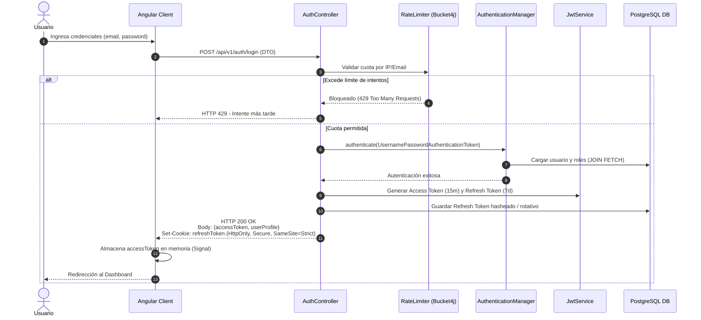
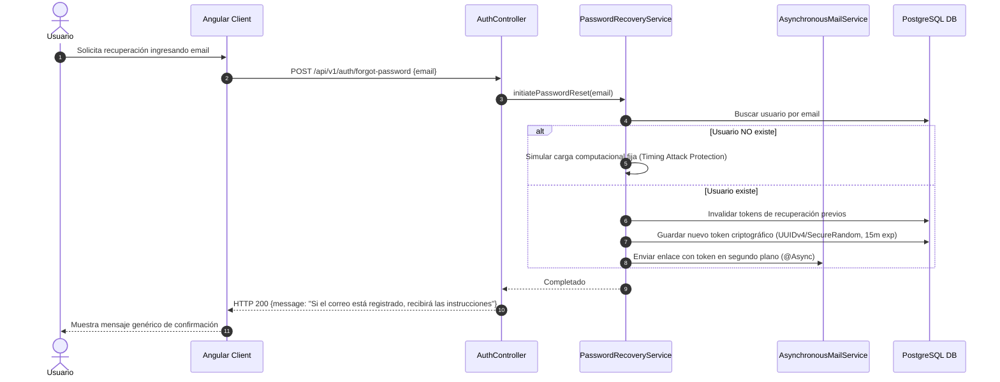
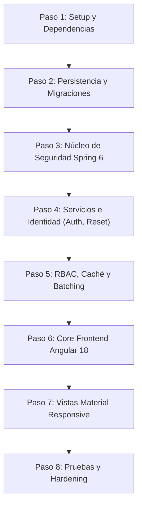

# DOCUMENTO DE ARQUITECTURA DE SOFTWARE (SAD) - METODOLOGÍA RUP
## Módulo Empresarial de Autenticación, Autorización y Gestión de Identidades (IAM)

---

### Metadatos del Documento
- **Proyecto:** Módulo de Seguridad y Autenticación Empresarial
- **Arquitectura:** Clean Architecture / Capas desacopladas (Backend: Spring Boot 3.3+, Frontend: Angular 18+ con Material)
- **Metodología:** RUP (Rational Unified Process)
- **Estado:** Aprobado para Construcción
- **Versión:** 1.0.0

---

## 1. FASE DE INICIO (INCEPTION)

### 1.1. Visión y Objetivos del Negocio
El objetivo es proveer una solución transversal, desacoplada, de alto rendimiento y grado de seguridad bancaria/empresarial para la gestión de autenticación, autorización basada en roles y permisos granulares (RBAC), recuperación de credenciales, y administración de perfiles y usuarios.

### 1.2. Alcance del Sistema
El módulo comprende:
1. **Mecanismo de Autenticación Seguro:** Flujo Dual-Token (Access Token de corta duración en memoria + Refresh Token rotativo en Cookie `HttpOnly`, `Secure`, `SameSite=Strict`).
2. **Registro Flexible:** Configurable por administrador mediante parámetros dinámicos en base de datos/caché (habilitar/deshabilitar autoregistro público).
3. **Recuperación Asíncrona de Contraseñas:** Enlace temporal criptográficamente seguro enviado por correo con protección estricta contra ataques de enumeración de usuarios (User Enumeration Timing-Safe).
4. **Gestión Granular de Identidades (RBAC):** Usuarios $\rightarrow$ Roles $\rightarrow$ Permisos. Caching de nivel de sesión y validación en cada petición REST.
5. **Seguridad Defensiva en Profundidad:**
   - Hash irreversible mediante **Argon2id** o **BCrypt (factor de costo 12)**.
   - Limitador de tasa (*Rate Limiting*) para mitigar fuerza bruta.
   - Ofuscación de errores: mensajes uniformes y tiempos de respuesta estandarizados.
   - Zero-Knowledge Frontend: ningún hash, contraseña o dato confidencial viaja al cliente.
6. **Rendimiento Óptimo:**
   - Operaciones batch en JPA (`@BatchSize`, fetch joins).
   - Caché local con Caffeine o distribuida con Redis para roles/permisos/configuraciones.
   - Transferencia de datos mediante Proyecciones/DTOs estrictos sin *N+1 queries*.

### 1.3. Matriz de Requisitos Funcionales (RF) - Ajustada al Sistema "FUTBOL S.A."

| Código | Requisito Funcional | Descripción Detallada | Componente / Implementación |
| :--- | :--- | :--- | :--- |
| **RF-01** | Inicio de Sesión Seguro (Login) | Autenticación mediante correo y contraseña contra hash BCrypt (factor 12). Soporte para "Recordarme". Emisión de Access Token JWT (15 min) y Refresh Token rotativo en Cookie `HttpOnly; SameSite=Strict`. | `AuthController.java` (`/api/v1/auth/login`)<br>`LoginComponent.ts` (Diseño 1 - Split Stadium) |
| **RF-02** | Cierre de Sesión Seguro (Logout) | Invalidación de sesión, revocación del token de refresco en base de datos H2 y eliminación de la cookie de sesión del navegador (`Max-Age=0`). | `AuthController.java` (`/api/v1/auth/logout`)<br>`MainLayoutComponent.ts` (Botón Cerrar Sesión) |
| **RF-03** | Autorregistro Configurable | Registro público condicionado al parámetro dinámico `ALLOW_PUBLIC_REGISTRATION`. Si está deshabilitado por el administrador, bloquea el alta y emite alerta. Validador visual de fortaleza de clave. | `AuthController.java` (`/api/v1/auth/register`)<br>`RegisterComponent.ts` / `ConfigComponent.ts` |
| **RF-04** | Registro Administrativo de Usuarios | Alta interna de colaboradores desde el panel de administración asignando correo, nombre, rol (Analista, Administrador, Editor, Visualizador) y switch de estado inicial (Activo/Inactivo). | `UserRegisterComponent.ts` (Diseño 3)<br>`UserService.java` |
| **RF-05** | Recuperación Asíncrona de Clave | Solicitud de restablecimiento vía correo. Emisión de token temporal único (15 min) con protección anti-enumeración de cuentas (*Timing-Safe* uniforme). | `AuthController.java` (`/api/v1/auth/forgot-password`)<br>`ForgotPasswordComponent.ts` (Diseño 6 - Candado) |
| **RF-06** | Restablecimiento de Contraseña | Validación del token efímero recibido, actualización segura de contraseña en BCrypt y revocación automática de todas las sesiones activas previas del usuario. | `AuthController.java` (`/api/v1/auth/reset-password`)<br>`ResetPasswordComponent.ts` (Diseño 7 - Candado) |
| **RF-07** | Gestión de Usuarios (Data Table) | Directorio administrativo de usuarios con barra de búsqueda reactiva, visualización de avatares con iniciales por color (**JP**, **ML**, **CR**), chips de roles por color y badges de estado. | `AdminUserController.java` (`/api/v1/admin/users`)<br>`UserManagementComponent.ts` (Diseño 4) |
| **RF-08** | Operaciones por Lotes (Batch) | Modificación masiva y optimizada en base de datos: activación/desactivación en lote de usuarios y asignación masiva de roles en una sola transacción SQL. | `AdminUserController.java` (`/batch-status`, `/batch-roles`)<br>`UserRepository.java` (`updateStatusInBatch`) |
| **RF-09** | Control de Acceso por Roles y Permisos (RBAC) | Autorización granular en frontend y backend según especificación de matriz de menú con menú agrupador **Seguridad**:<br>• **Super Administrador:** Acceso a Dashboard, Mi Perfil y menú **Seguridad** (*Usuarios, Roles y Permisos, Reportes, Configuración*).<br>• **Administrador:** Acceso a Dashboard, Mi Perfil y menú **Seguridad** (*Usuarios, Roles y Permisos, Reportes*).<br>• **Usuario:** Acceso a 1 opción (*Mi Perfil*).<br>• **Usuario Estándar:** Ningún acceso (0 opciones, bloqueo defensivo). | `SecurityConfig.java`<br>`MainLayoutComponent.ts`<br>`AuthService.ts`<br>`app.routes.ts` (Guards) |
| **RF-10** | Perfil Personal y Cambio de Clave | Consulta de credenciales y roles asignados. Formulario de cambio de contraseña que exige ingresar y validar la contraseña actual antes de aplicar el nuevo hash. | `UserProfileController.java` (`/api/v1/profile/me`)<br>`ProfileComponent.ts` (Diseño 5 - Avatar Grande) |
| **RF-11** | Panel Principal y Métricas (Dashboard) | Vista ejecutiva en `/dashboard` con 4 KPIs en tiempo real (*Total Usuarios: 12*, *Usuarios Activos: 11*, *Roles Definidos: 3*, *Sesiones Activas: 5*), tabla de *Accesos Recientes* y monitor de *Sistema Operativo*. | `DashboardComponent.ts` (Diseño 2)<br>`AuthService.ts` |
| **RF-12** | Auditoría Forense de Seguridad | Registro inmutable de eventos de acceso (`LOGIN_SUCCESS`, `LOGIN_FAILED`, `LOGIN_BLOCKED`, `PASSWORD_RESET`, `ADMIN_PASSWORD_RESET`) con dirección IP, User-Agent, fecha/hora y detalle JSON. | `AuditService.java` (`audit_logs`)<br>`ReportsComponent.ts` |
| **RF-13** | Reseteo Administrativo de Contraseñas | El usuario con perfil de Administrador (`ROLE_ADMIN` o `ROLE_SUPER_ADMIN`) puede restablecer de forma directa o enviar enlace de recuperación de contraseña para cualquier usuario del sistema, con generación de clave temporal segura, hash BCrypt factor 12, desbloqueo automático de cuenta y revocación inmediata de sesiones activas concurrentes. | `AdminUserController.java` (`/api/v1/admin/users/{id}/reset-password`, `/send-reset-link`)<br>`UserManagementComponent.ts` (Modal de Reseteo y botón en tabla) |

---

### 1.4. Matriz de Requisitos No Funcionales (RNF) - Ajustada al Sistema

| Código | Dimensión | Requisito No Funcional | Estándar / Mecanismo de Implementación |
| :--- | :--- | :--- | :--- |
| **RNF-01** | **Seguridad** | Cifrado Criptográfico de Contraseñas | Las contraseñas **nunca** se almacenan en texto claro. Se utiliza **BCrypt con factor de costo 12** ($2^{12} = 4096$ rondas de dispersión) con sal aleatoria generada por usuario. |
| **RNF-02** | **Seguridad** | Zero-Knowledge Frontend (Sin Exposición de Secretos) | El backend **nunca** expone contraseñas, hashes ni refresh tokens en respuestas JSON. Se aplican Records DTO inmutables y sanitización de modelos de dominio. |
| **RNF-03** | **Seguridad** | Protección Anti-Enumeración (*Timing-Safe*) | El endpoint `/forgot-password` emite una respuesta genérica uniforme tanto si el correo existe como si no. Si el usuario no existe, ejecuta una operación dummy de BCrypt para igualar el tiempo de cómputo del hilo. |
| **RNF-04** | **Seguridad** | Gestión Segura de Sesiones (Dual-Token) | **Access Token:** Corta vida (15 min) conservado únicamente en memoria volátil (Angular Signals).<br>**Refresh Token:** Rotativo (7 días) encapsulado en cookie `HttpOnly; SameSite=Strict; Path=/api/v1/auth`. Con detección de robo por reutilización. |
| **RNF-05** | **Seguridad** | Mitigación de Fuerza Bruta y Rate Limiting | Algoritmo **Token Bucket** en memoria (`RateLimiterService`) con cuota máxima de 10 peticiones/minuto por IP en endpoints de autenticación. Bloqueo temporal automático de cuenta por 15 minutos tras 5 intentos fallidos consecutivos. |
| **RNF-06** | **Seguridad** | Autorización Defensiva en el Servidor (Zero-Trust) | Todas las operaciones REST validan permisos en backend mediante Spring Security y anotaciones `@PreAuthorize`. Las validaciones del frontend son puramente ergonómicas. |
| **RNF-07** | **Rendimiento** | Eliminación del Problema $N+1$ en Persistencia | Repositorios Spring Data JPA utilizan consultas optimizadas con `JOIN FETCH` y `@EntityGraph` para cargar usuario, roles y permisos en una única sentencia SQL. |
| **RNF-08** | **Rendimiento** | Operaciones Masivas por Lotes (*Batching*) | Configuración de Hibernate en `application.yml` con `batch_size: 50`, `order_inserts: true` y `order_updates: true`, minimizando viajes red a la base de datos en altas y bajas. |
| **RNF-09** | **Rendimiento** | Estrategia de Caché L2 en Memoria | Integración de **Caffeine Cache** para autoridades de usuarios y parámetros del sistema con expiración a los 30 minutos y desalojo selectivo (`@CacheEvict`) ante cambios. |
| **RNF-10** | **Rendimiento** | Latencia de Autenticación y Consulta | Latencia percentil $p95 < 200\text{ ms}$ en generación de tokens y $p95 < 30\text{ ms}$ para validaciones cacheadas y comprobación de permisos. |
| **RNF-11** | **Arquitectura** | Desacoplamiento Clean Architecture | Separación absoluta entre Backend (Spring Boot 3.3 REST API), Frontend (Angular 18+ SPA Standalone) y Persistencia (H2 Database en memoria compatible con PostgreSQL). |
| **RNF-12** | **Usabilidad** | Sistema de Diseño Responsivo "FUTBOL S.A." | Interfaz adaptativa construida con **Angular Material**, paleta corporativa azul `#0066ff` y azul marino `#0b1a30`, avatares circulares con iniciales, badges de roles/estados y diseño Mobile-First. |
| **RNF-13** | **Portabilidad** | Despliegue sin Dependencias Externas Complejas | Base de datos H2 embebida (`jdbc:h2:mem:seguridad_db`) con consola web administrativa `/h2-console`, scripts ejecutables `.bat` para Windows y compatibilidad total con `zone.js`. |

---

### 1.5. Matriz de Trazabilidad RUP (Requisitos vs Componentes Técnicos)

| Requisito | Entidad de Persistencia | Servicio Backend | Endpoint REST | Vista / Componente Frontend |
| :---: | :--- | :--- | :--- | :--- |
| **RF-01** | `User`, `RefreshToken` | `AuthService.java` | `POST /api/v1/auth/login` | `LoginComponent.ts` (Diseño 1) |
| **RF-02** | `RefreshToken` | `AuthService.java` | `POST /api/v1/auth/logout` | `MainLayoutComponent.ts` |
| **RF-03** | `SystemConfiguration` | `AuthService.java` | `POST /api/v1/auth/register` | `RegisterComponent.ts` |
| **RF-04** | `User`, `Role` | `UserService.java` | `POST /api/v1/auth/register` | `UserRegisterComponent.ts` (Diseño 3) |
| **RF-05** | `PasswordResetToken` | `AuthService.java` | `POST /api/v1/auth/forgot-password` | `ForgotPasswordComponent.ts` (Diseño 6) |
| **RF-06** | `PasswordResetToken`, `User` | `AuthService.java` | `POST /api/v1/auth/reset-password` | `ResetPasswordComponent.ts` (Diseño 7) |
| **RF-07** | `User`, `Role` | `UserService.java` | `GET /api/v1/admin/users` | `UserManagementComponent.ts` (Diseño 4) |
| **RF-08** | `User`, `Role` | `UserService.java` | `POST /api/v1/admin/users/batch-*` | `AdminDashboardComponent.ts` |
| **RF-09** | `Role`, `Permission` | `CustomUserDetailsService`, `AuthService.java` | `All Endpoints` | `MainLayoutComponent.ts`, `app.routes.ts`, `AuthService.ts` |
| **RF-10** | `User` | `UserService.java` | `POST /api/v1/profile/change-password` | `ProfileComponent.ts` (Diseño 5) |
| **RF-11** | `AuditLog`, `User` | `UserService.java` | `GET /api/v1/admin/users` | `DashboardComponent.ts` (Diseño 2) |
| **RF-12** | `AuditLog` | `AuditService.java`, `AdminReportController.java` | `GET /api/v1/admin/reports/audit-logs`<br>`GET /api/v1/admin/reports/metrics` | `ReportsComponent.ts` |
| **RF-13** | `User`, `PasswordResetToken`, `AuditLog` | `UserService.java`, `AdminUserController.java` | `POST /api/v1/admin/users/{id}/reset-password`<br>`POST /api/v1/admin/users/{id}/send-reset-link` | `UserManagementComponent.ts` (Acción Llave y Modal) |

---

## 2. FASE DE ELABORACIÓN (ELABORATION)

### 2.1. Arquitectura de Software (SAD)

#### 2.1.1. Vista Lógica - Clean Architecture (Backend Spring Boot)
El backend se estructura siguiendo el principio de inversión de dependencias y responsabilidad única:
```
com.empresa.seguridad/
├── domain/                      # Entidades del dominio y reglas de negocio puras
│   ├── model/                   # Usuario, Rol, Permiso, RefreshToken, PasswordResetToken
│   └── repository/              # Interfaces de persistencia (Puertos de salida)
├── application/                 # Casos de uso y orquestación
│   ├── dto/                     # DTOs de entrada y salida (Records inmutables)
│   ├── service/                 # Implementación de lógica de negocio (AuthService, UserService)
│   └── mapper/                  # Mapeadores Entity <-> DTO (MapStruct)
└── infrastructure/              # Adaptadores externos y framework
    ├── config/                  # Spring Security 6 (Lambda DSL), Caché, Rate Limiter
    ├── security/                # JwtProvider, JwtFilter, CustomUserDetailsService
    ├── persistence/             # Spring Data JPA Repositories
    ├── mail/                    # Servicio asíncrono de envío de correos (JavaMailSender)
    └── web/                     # Controladores REST (@RestController)
```

#### 2.1.2. Vista de Componentes - Frontend (Angular 18+ Standalone)
```
src/app/
├── core/                        # Singleton: Servicios transversales, Guards e Interceptors
│   ├── auth/                    # AuthService, TokenStorageService (In-Memory Signals)
│   ├── guards/                  # auth.guard.ts, role.guard.ts, registration-enabled.guard.ts
│   └── interceptors/            # auth.interceptor.ts (Bearer token + auto-refresh con mutex)
├── shared/                      # Componentes reutilizables, directivas (HasPermissionDirective), Pipes
└── features/                    # Módulos perezosos (Lazy Loaded)
    ├── auth/                    # login, register, forgot-password, reset-password
    ├── profile/                 # user-profile, change-password
    └── admin/                   # user-management, role-management, system-config
```

---

### 2.2. Diagramas de Secuencia Arquitectónicos

#### 2.2.1. Flujo de Autenticación con Doble Token y Cookie Segura


#### 2.2.2. Flujo de Recuperación de Contraseña (Timing-Safe Anti-Enumeration)


---

## 3. FASE DE CONSTRUCCIÓN (CONSTRUCTION): IMPLEMENTACIÓN TÉCNICA

### 3.1. Spring Security 6+ con Enfoque Funcional / Lambda DSL
En Spring Security 6 se elimina completamente la herencia de `WebSecurityConfigurerAdapter` y se adoptan exclusivamente expresiones Lambda para la configuración del `SecurityFilterChain`, garantizando inmutabilidad y seguridad declarativa.

#### Implementación Completa de `SecurityConfig.java`
```java
package com.empresa.seguridad.infrastructure.config;

import com.empresa.seguridad.infrastructure.security.JwtAuthenticationEntryPoint;
import com.empresa.seguridad.infrastructure.security.JwtAuthenticationFilter;
import lombok.RequiredArgsConstructor;
import org.springframework.context.annotation.Bean;
import org.springframework.context.annotation.Configuration;
import org.springframework.http.HttpMethod;
import org.springframework.security.authentication.AuthenticationManager;
import org.springframework.security.authentication.AuthenticationProvider;
import org.springframework.security.authentication.dao.DaoAuthenticationProvider;
import org.springframework.security.config.annotation.authentication.configuration.AuthenticationConfiguration;
import org.springframework.security.config.annotation.method.configuration.EnableMethodSecurity;
import org.springframework.security.config.annotation.web.builders.HttpSecurity;
import org.springframework.security.config.annotation.web.configuration.EnableWebSecurity;
import org.springframework.security.config.annotation.web.configurers.AbstractHttpConfigurer;
import org.springframework.security.config.http.SessionCreationPolicy;
import org.springframework.security.core.userdetails.UserDetailsService;
import org.springframework.security.crypto.bcrypt.BCryptPasswordEncoder;
import org.springframework.security.crypto.password.PasswordEncoder;
import org.springframework.security.web.SecurityFilterChain;
import org.springframework.security.web.authentication.UsernamePasswordAuthenticationFilter;
import org.springframework.web.cors.CorsConfiguration;
import org.springframework.web.cors.CorsConfigurationSource;
import org.springframework.web.cors.UrlBasedCorsConfigurationSource;

import java.util.List;

@Configuration
@EnableWebSecurity
@EnableMethodSecurity(prePostEnabled = true)
@RequiredArgsConstructor
public class SecurityConfig {

    private final JwtAuthenticationFilter jwtAuthFilter;
    private final UserDetailsService userDetailsService;
    private final JwtAuthenticationEntryPoint unauthorizedHandler;

    @Bean
    public SecurityFilterChain securityFilterChain(HttpSecurity http) throws Exception {
        return http
            // 1. Deshabilitar CSRF dado que el estado se maneja con JWT y Cookies SameSite=Strict
            .csrf(AbstractHttpConfigurer::disable)
            
            // 2. Configuración CORS explícita y restringida
            .cors(cors -> cors.configurationSource(corsConfigurationSource()))
            
            // 3. Manejo de excepciones de autenticación y autorización no autorizada
            .exceptionHandling(exceptions -> exceptions
                .authenticationEntryPoint(unauthorizedHandler)
            )
            
            // 4. Arquitectura Stateless: sin sesiones en el contenedor servlet
            .sessionManagement(session -> session
                .sessionCreationPolicy(SessionCreationPolicy.STATELESS)
            )
            
            // 5. Definición de rutas protegidas mediante Lambda DSL
            .authorizeHttpRequests(auth -> auth
                // Rutas públicas de autenticación y salud
                .requestMatchers(HttpMethod.POST, "/api/v1/auth/login").permitAll()
                .requestMatchers(HttpMethod.POST, "/api/v1/auth/register").permitAll()
                .requestMatchers(HttpMethod.POST, "/api/v1/auth/refresh-token").permitAll()
                .requestMatchers(HttpMethod.POST, "/api/v1/auth/forgot-password").permitAll()
                .requestMatchers(HttpMethod.POST, "/api/v1/auth/reset-password").permitAll()
                .requestMatchers(HttpMethod.GET, "/api/v1/auth/registration-status").permitAll()
                .requestMatchers("/actuator/health").permitAll()
                
                // Rutas exclusivas de administración
                .requestMatchers("/api/v1/admin/**").hasAuthority("ROLE_ADMIN")
                
                // Cualquier otra petición requiere autenticación activa
                .anyRequest().authenticated()
            )
            
            // 6. Configurar proveedor de autenticación
            .authenticationProvider(authenticationProvider())
            
            // 7. Filtro JWT antes del filtro estándar de usuario y contraseña
            .addFilterBefore(jwtAuthFilter, UsernamePasswordAuthenticationFilter.class)
            
            .build();
    }

    @Bean
    public AuthenticationProvider authenticationProvider() {
        DaoAuthenticationProvider authProvider = new DaoAuthenticationProvider();
        authProvider.setUserDetailsService(userDetailsService);
        authProvider.setPasswordEncoder(passwordEncoder());
        return authProvider;
    }

    @Bean
    public AuthenticationManager authenticationManager(AuthenticationConfiguration config) throws Exception {
        return config.getAuthenticationManager();
    }

    @Bean
    public PasswordEncoder passwordEncoder() {
        // Factor de costo 12: equilibrio óptimo entre resistencia a fuerza bruta y latencia
        return new BCryptPasswordEncoder(12);
    }

    @Bean
    public CorsConfigurationSource corsConfigurationSource() {
        CorsConfiguration config = new CorsConfiguration();
        config.setAllowedOrigins(List.of("http://localhost:4200", "https://app.miempresa.com"));
        config.setAllowedMethods(List.of("GET", "POST", "PUT", "PATCH", "DELETE", "OPTIONS"));
        config.setAllowedHeaders(List.of("Authorization", "Content-Type", "X-Requested-With", "Accept"));
        config.setAllowCredentials(true); // Requerido para transmisión segura de Cookies
        config.setMaxAge(3600L);

        UrlBasedCorsConfigurationSource source = new UrlBasedCorsConfigurationSource();
        source.registerCorsConfiguration("/api/**", config);
        return source;
    }
}
```

---

### 3.2. Filtro JWT Optimizado de Alto Rendimiento (`JwtAuthenticationFilter.java`)
```java
package com.empresa.seguridad.infrastructure.security;

import jakarta.servlet.FilterChain;
import jakarta.servlet.ServletException;
import jakarta.servlet.http.HttpServletRequest;
import jakarta.servlet.http.HttpServletResponse;
import lombok.NonNull;
import lombok.RequiredArgsConstructor;
import lombok.extern.slf4j.Slf4j;
import org.springframework.security.authentication.UsernamePasswordAuthenticationToken;
import org.springframework.security.core.context.SecurityContextHolder;
import org.springframework.security.core.userdetails.UserDetails;
import org.springframework.security.core.userdetails.UserDetailsService;
import org.springframework.security.web.authentication.WebAuthenticationDetailsSource;
import org.springframework.stereotype.Component;
import org.springframework.util.StringUtils;
import org.springframework.web.filter.OncePerRequestFilter;

import java.io.IOException;

@Slf4j
@Component
@RequiredArgsConstructor
public class JwtAuthenticationFilter extends OncePerRequestFilter {

    private final JwtService jwtService;
    private final UserDetailsService userDetailsService;

    @Override
    protected void doFilterInternal(
            @NonNull HttpServletRequest request,
            @NonNull HttpServletResponse response,
            @NonNull FilterChain filterChain
    ) throws ServletException, IOException {

        final String authHeader = request.getHeader("Authorization");
        if (!StringUtils.hasText(authHeader) || !authHeader.startsWith("Bearer ")) {
            filterChain.doFilter(request, response);
            return;
        }

        final String jwt = authHeader.substring(7);
        final String userEmail;

        try {
            userEmail = jwtService.extractUsername(jwt);
        } catch (Exception e) {
            log.warn("Token JWT inválido o expirado: {}", e.getMessage());
            filterChain.doFilter(request, response);
            return;
        }

        // Si el usuario no está ya autenticado en el hilo actual
        if (userEmail != null && SecurityContextHolder.getContext().getAuthentication() == null) {
            UserDetails userDetails = this.userDetailsService.loadUserByUsername(userEmail);

            if (jwtService.isTokenValid(jwt, userDetails)) {
                UsernamePasswordAuthenticationToken authToken = new UsernamePasswordAuthenticationToken(
                        userDetails,
                        null,
                        userDetails.getAuthorities()
                );
                authToken.setDetails(new WebAuthenticationDetailsSource().buildDetails(request));
                SecurityContextHolder.getContext().setAuthentication(authToken);
            }
        }

        filterChain.doFilter(request, response);
    }
}
```

---

### 3.3. Servicio de Autenticación Defensivo con Protección contra Enumeración
```java
package com.empresa.seguridad.application.service;

import com.empresa.seguridad.application.dto.*;
import com.empresa.seguridad.domain.model.User;
import com.empresa.seguridad.domain.repository.SystemConfigRepository;
import com.empresa.seguridad.domain.repository.UserRepository;
import com.empresa.seguridad.infrastructure.security.JwtService;
import lombok.RequiredArgsConstructor;
import lombok.extern.slf4j.Slf4j;
import org.springframework.security.authentication.AuthenticationManager;
import org.springframework.security.authentication.BadCredentialsException;
import org.springframework.security.authentication.UsernamePasswordAuthenticationToken;
import org.springframework.security.crypto.password.PasswordEncoder;
import org.springframework.stereotype.Service;
import org.springframework.transaction.annotation.Transactional;

@Slf4j
@Service
@RequiredArgsConstructor
public class AuthService {

    private final UserRepository userRepository;
    private final SystemConfigRepository configRepository;
    private final PasswordEncoder passwordEncoder;
    private final JwtService jwtService;
    private final AuthenticationManager authenticationManager;
    private final RefreshTokenService refreshTokenService;
    private final EmailService emailService;

    @Transactional(readOnly = true)
    public LoginResponse authenticate(LoginRequest request) {
        // Autenticar mediante AuthenticationManager
        authenticationManager.authenticate(
            new UsernamePasswordAuthenticationToken(request.email().toLowerCase().trim(), request.password())
        );

        User user = userRepository.findByEmailWithRolesAndPermissions(request.email().toLowerCase().trim())
                .orElseThrow(() -> new BadCredentialsException("Credenciales inválidas"));

        String accessToken = jwtService.generateAccessToken(user);
        String refreshToken = refreshTokenService.createOrRotateRefreshToken(user);

        return new LoginResponse(
                accessToken,
                refreshToken,
                new UserSummaryResponse(user.getId(), user.getFullName(), user.getEmail(), user.getRoleNames())
        );
    }

    @Transactional
    public void register(RegisterRequest request) {
        // 1. Validar si el autoregistro está habilitado por configuración administrativa
        boolean isRegistrationOpen = configRepository.findByKey("ALLOW_PUBLIC_REGISTRATION")
                .map(c -> Boolean.parseBoolean(c.getConfigValue()))
                .orElse(false);

        if (!isRegistrationOpen) {
            throw new IllegalStateException("El registro público de usuarios se encuentra actualmente desactivado por políticas corporativas.");
        }

        // 2. Prevenir colisión de cuentas (si existe, se retorna mensaje neutro o controlado)
        if (userRepository.existsByEmail(request.email().toLowerCase().trim())) {
            throw new IllegalArgumentException("No fue posible completar la solicitud con los datos proporcionados.");
        }

        // 3. Crear entidad con hash seguro
        User newUser = User.builder()
                .fullName(request.fullName().trim())
                .email(request.email().toLowerCase().trim())
                .passwordHash(passwordEncoder.encode(request.password()))
                .enabled(true)
                .accountNonLocked(true)
                .build();

        userRepository.save(newUser);
    }

    @Transactional
    public void requestPasswordReset(ForgotPasswordRequest request) {
        String email = request.email().toLowerCase().trim();
        
        // Prevención de enumeración de usuarios:
        // Si el usuario no existe, se consume un tiempo equivalente para mitigar análisis de tiempos (Timing Attack)
        userRepository.findByEmail(email).ifPresentOrElse(
            user -> {
                String token = refreshTokenService.generatePasswordResetToken(user);
                emailService.sendResetPasswordEmail(user.getEmail(), token);
            },
            () -> {
                // Simulación de hash dummy para igualar el tiempo de cómputo del hilo
                passwordEncoder.matches("dummy_check_12345", "$2a$12$e8Y57zMh6lD2Z9fU2G2CGeZpYIkg.E5f71K6JkYgI/K7K8z8kEhyq");
            }
        );
    }
}
```

---

### 3.4. Arquitectura Frontend (Angular 18+ Standalone & Material)

#### 3.4.1. Interceptor de Tokens Funcional (`auth.interceptor.ts`)
Maneja la inyección automática del token en memoria y la reautenticación transparente (*silent refresh*) con mutex reactivo ante errores 401:

```typescript
import { HttpInterceptorFn, HttpRequest, HttpHandlerFn, HttpErrorResponse } from '@angular/common/http';
import { inject } from '@angular/core';
import { AuthService } from '../services/auth.service';
import { catchError, switchMap, throwError } from 'rxjs';

export const authInterceptor: HttpInterceptorFn = (req: HttpRequest<unknown>, next: HttpHandlerFn) => {
  const authService = inject(AuthService);
  const token = authService.accessToken();

  let clonedRequest = req;
  // Solo adjunta encabezado Authorization si existe token en memoria y no es solicitud de login/refresh
  if (token && !req.url.includes('/api/v1/auth/login') && !req.url.includes('/api/v1/auth/refresh-token')) {
    clonedRequest = req.clone({
      setHeaders: {
        Authorization: `Bearer ${token}`
      },
      withCredentials: true // Permite enviar cookies HttpOnly (Refresh Token)
    });
  } else {
    clonedRequest = req.clone({ withCredentials: true });
  }

  return next(clonedRequest).pipe(
    catchError((error: HttpErrorResponse) => {
      if (error.status === 401 && !req.url.includes('/api/v1/auth/login')) {
        // Intentar renovación silenciosa de token
        return authService.refreshToken().pipe(
          switchMap((newToken) => {
            const retryRequest = req.clone({
              setHeaders: { Authorization: `Bearer ${newToken}` },
              withCredentials: true
            });
            return next(retryRequest);
          }),
          catchError((refreshErr) => {
            authService.logout();
            return throwError(() => refreshErr);
          })
        );
      }
      return throwError(() => error);
    })
  );
};
```

#### 3.4.2. Angular Guard Funcional con Permisos Granulares (`permission.guard.ts`)
```typescript
import { inject } from '@angular/core';
import { CanActivateFn, Router, ActivatedRouteSnapshot } from '@angular/router';
import { AuthService } from '../services/auth.service';
import { MatSnackBar } from '@angular/material/snack-bar';

export const permissionGuard: CanActivateFn = (route: ActivatedRouteSnapshot) => {
  const authService = inject(AuthService);
  const router = inject(Router);
  const snackBar = inject(MatSnackBar);

  const requiredPermission = route.data['permission'] as string;

  if (!authService.isAuthenticated()) {
    router.navigate(['/auth/login']);
    return false;
  }

  if (requiredPermission && !authService.hasPermission(requiredPermission)) {
    snackBar.open('Acceso denegado: No posee los permisos requeridos.', 'Cerrar', { duration: 4000 });
    router.navigate(['/dashboard']);
    return false;
  }

  return true;
};
```

---

## 4. FASE DE TRANSICIÓN (TRANSITION): DESPLIEGUE, PRUEBAS Y HARDENING

### 4.1. Matriz de Hardening de Producción
1. **Cabeceras HTTP de Seguridad (OWASP Secure Headers):**
   - `Content-Security-Policy (CSP)`: Restringe orígenes de scripts a `'self'`.
   - `Strict-Transport-Security (HSTS)`: Obliga a conexiones HTTPS `max-age=31536000; includeSubDomains`.
   - `X-Frame-Options: DENY` (Mitiga Clickjacking).
   - `X-Content-Type-Options: nosniff`.
2. **Rate Limiting Distribuido:**
   - 5 peticiones por minuto para endpoints `/login`, `/register`, `/forgot-password`.
   - 120 peticiones por minuto para endpoints autenticados generales.
3. **Auditoría Completa de Seguridad:**
   - Registro de accesos fallidos, cambios de rol y revocación de contraseñas con IP, User-Agent y Timestamp.

---

## 5. GUÍA MAESTRA DE PROMPTS PASO A PASO (PROMPT ENGINEERING RUP)

A continuación se detalla la secuencia secuencial de prompts estructurados que el equipo de desarrollo debe ejecutar para generar, implementar y validar cada subsistema del módulo sin vacíos de seguridad.



---

### PROMPT 1: Configuración de Dependencias y Arquitectura Base
```markdown
Actúa como Arquitecto de Software Senior especializado en Spring Boot 3 y Angular 18.
Configura el proyecto base para un módulo de autenticación empresarial:
1. Genera el archivo pom.xml para Spring Boot 3.3.x con Java 21, incluyendo las dependencias mínimas indispensables y sin librerías obsoletas:
   - spring-boot-starter-web
   - spring-boot-starter-security
   - spring-boot-starter-data-jpa
   - spring-boot-starter-validation
   - spring-boot-starter-mail
   - com.github.ben-manes.caffeine (para caché local de permisos)
   - jjwt-api, jjwt-impl, jjwt-jackson (0.12.x)
   - bucket4j-core (para rate limiting)
   - postgresql driver y flyway-core
2. Explica la estructura de paquetes Clean Architecture y las configuraciones de variables de entorno para JWT (claves RSA o secret seguro de 512 bits, tiempos de expiración y políticas de cookies).
```

---

### PROMPT 2: Creación del Modelo de Datos y Migración con Flyway
```markdown
Actúa como Ingeniero de Datos y Especialista en Seguridad.
Genera la migración SQL compatible con PostgreSQL (V1__init_security_schema.sql) siguiendo el modelo de datos RUP:
1. Tablas requeridas: users, roles, permissions, role_permissions, user_roles, refresh_tokens, password_reset_tokens, system_configurations, audit_logs.
2. Asegura que ningún campo de contraseña o token almacene datos en texto plano.
3. Añade índices B-Tree específicos para login por email, búsqueda de permisos y validación de tokens activos.
4. Incluye datos semilla (Seed Data) con roles ('ROLE_SUPER_ADMIN', 'ROLE_ADMIN', 'ROLE_USER'), permisos granulares ('USER_READ', 'USER_WRITE', 'CONFIG_MANAGE') y el parámetro 'ALLOW_PUBLIC_REGISTRATION' configurado en 'false' por defecto.
```

---

### PROMPT 3: Implementación del Motor de Seguridad Spring Security 6 con Lambdas
```markdown
Actúa como Especialista en Spring Security 6.
Desarrolla la configuración completa del SecurityFilterChain aplicando 100% Lambda DSL:
1. Crea SecurityConfig.java asegurando estado STATELESS, desactivación de CSRF tradicional debido a JWT + SameSite Cookie, y reglas estrictas de autorización por HTTP Method y URL.
2. Implementa JwtService.java utilizando io.jsonwebtoken versión 0.12.x con algoritmos HMAC-SHA256/512, extrayendo claims, roles y fecha de expiración.
3. Crea JwtAuthenticationFilter.java extendiendo OncePerRequestFilter, evitando consultas repetitivas a la base de datos si el token ya contiene las autoridades válidas.
4. Implementa el manejador personalizado de excepciones JwtAuthenticationEntryPoint para responder siempre en formato JSON estándar (RFC 7807 Problem Details) sin revelar trazas internas.
```

---

### PROMPT 4: Lógica de Negocio, Registro Configurable y Prevención de Enumeración
```markdown
Actúa como Desarrollador Backend Senior en Java.
Implementa los servicios de aplicación con enfoque defensivo:
1. AuthService.java:
   - authenticate(): Valida credenciales, genera Access Token y almacena Refresh Token rotativo en base de datos.
   - register(): Lee el parámetro 'ALLOW_PUBLIC_REGISTRATION' desde la base de datos; si es falso, rechaza el registro con mensaje corporativo. Encripta la contraseña con BCrypt (fuerza 12).
   - requestPasswordReset(): Aplica protección contra Timing Attacks (tiempo de respuesta constante exista o no el correo) y genera un token único UUIDv4 con 15 minutos de caducidad.
   - resetPassword(): Valida el token, actualiza la contraseña y revoca de inmediato todas las sesiones activas del usuario.
2. Diseña los DTOs inmutables en Java Records con validaciones Jakarta Bean Validation estrictas (longitud mínima 12 caracteres, mayúsculas, minúsculas, dígitos y símbolos).
```

---

### PROMPT 5: Gestión de Usuarios, Roles, Permisos y Optimización por Lotes (Batch)
```markdown
Actúa como Arquitecto de Base de Datos y Backend.
Desarrolla el servicio y repositorio de administración de identidades:
1. Implementa UserRepository con consultas Spring Data JPA optimizadas utilizando @EntityGraph y JOIN FETCH para cargar roles y permisos en una sola consulta SQL, eliminando el problema N+1.
2. Implementa asignación y desasignación por lotes de roles a usuarios (batch update) para minimizar viajes al servidor.
3. Integra Caffeine Cache con la anotación @Cacheable para almacenar los roles y permisos del usuario autenticado, invalidando la caché (@CacheEvict) únicamente cuando un administrador modifique sus privilegios.
```

---

### PROMPT 6: Arquitectura Frontend Base en Angular 18 con Signals
```markdown
Actúa como Arquitecto Frontend experto en Angular 18 Standalone Components y Signals.
Crea la capa central (Core) de autenticación:
1. Implementa AuthService con Signals reactivos (currentUser, isAuthenticated, userPermissions).
2. Desarrolla el auth.interceptor.ts funcional que inyecte el Access Token en memoria y capture errores 401 para ejecutar un refresco silencioso de token contra /api/v1/auth/refresh-token.
3. Diseña los Guards funcionales: authGuard, roleGuard y registrationStatusGuard (este último consulta si el registro está activo antes de cargar la ruta /register).
```

---

### PROMPT 7: Vistas Responsivas con Angular Material
```markdown
Actúa como Diseñador UI y Desarrollador Frontend Angular Material.
Desarrolla los componentes visuales responsivos y accesibles (WCAG 2.1 AA):
1. LoginComponent: Formulario reactivo con validaciones visuales, toggle de visibilidad de contraseña (mat-icon), estado de carga (mat-spinner) y notificación mediante MatSnackBar.
2. RegisterComponent: Formulario con medidor visual de fortaleza de contraseña y validación en tiempo real de coincidencia de contraseñas.
3. ForgotPasswordComponent y ResetPasswordComponent: Vistas limpias con mensajes explicativos y sin revelar estado de existencia de cuentas.
4. UserProfileComponent: Vista de detalles personales con formulario para cambio seguro de contraseña solicitando la contraseña actual.
5. Utiliza Angular Material (MatCard, MatFormField, MatInput, MatButton, MatProgressBar) con diseño Mobile-First y Flexbox/CSS Grid.
```

---

### PROMPT 8: Tabla de Gestión de Usuarios y Permisos con Operaciones Batch
```markdown
Actúa como Desarrollador Full-Stack Angular & Spring Boot.
Construye la vista de administración de usuarios y roles:
1. Implementa un MatTable con paginación en servidor (MatPaginator), ordenamiento (MatSort) y selección múltiple por checkboxes (SelectionModel).
2. Agrega barra de acciones para operaciones por lotes: Activar Usuarios, Desactivar Usuarios, Asignar Rol en Lote.
3. Modales de confirmación con MatDialog y directiva personalizada *hasPermission="'USER_WRITE'" para ocultar o deshabilitar botones de acción a usuarios no autorizados.
```

---

### PROMPT 9: Pruebas Automatizadas, Seguridad SAST y Verificación
```markdown
Actúa como Ingeniero de Calidad y Seguridad (QA/AppSec).
Genera la suite de pruebas unitarias y de integración:
1. Pruebas de integración con MockMvc y @SpringBootTest para verificar que las rutas protegidas retornen 401 si no hay token y 403 si el rol es insuficiente.
2. Prueba específica para el flujo de recuperación de contraseña garantizando que la respuesta y el tiempo de ejecución sean uniformes tanto para correos registrados como inexistentes.
3. Script de pruebas de carga en k6 para simular 500 inicios de sesión concurrentes y verificar que la latencia p95 permanezca bajo 250ms y que el Rate Limiter bloquee a partir del 6to intento abusivo.
```
