# MODELO DE DATOS - METODOLOGÍA RUP
## Disciplina de Análisis y Diseño: Módulo de Seguridad y Autenticación Empresarial

---

### Metadatos del Documento
- **Proyecto:** Módulo Empresarial de Autenticación, Autorización y Gestión de Identidades (IAM)
- **Metodología:** RUP (Rational Unified Process) - Artefacto: *Data Model*
- **Motor de Base de Datos Objetivo:** PostgreSQL 15+ / 16 (Compatible con Oracle / SQL Server / MySQL mediante ANSI SQL estándar)
- **Versión:** 1.0.0
- **Nivel de Normalización:** Tercera Forma Normal (3NF) y Forma Normal de Boyce-Codd (BCNF)

---

## 1. INTRODUCCIÓN Y ENFOQUE METODOLÓGICO RUP

En la metodología RUP, el **Modelo de Datos** es un artefacto clave de la disciplina de Análisis y Diseño. Su propósito es estructurar la persistencia de la información requerida por los casos de uso del sistema garantizando:
1. **Integridad Referencial y Consistencia:** Reglas estrictas de validación a nivel de base de datos.
2. **Seguridad Defensiva:** Prevención absoluta de almacenamiento de contraseñas en texto claro, anonimización y protección contra fugas de identificadores predecibles mediante el uso de UUIDs.
3. **Escalabilidad y Alto Rendimiento:** Índices optimizados para lecturas concurrentes rápidas durante el proceso de autenticación, evitando cuellos de botella en operaciones de validación de tokens y permisos.

---

## 2. MODELO CONCEPTUAL DE DATOS (CDM)

El modelo conceptual describe las entidades del negocio y sus relaciones semánticas sin depender del motor de persistencia:

- **Usuario (`User`):** Representa a la entidad humana o servicio con identidad en la plataforma.
- **Rol (`Role`):** Agrupación lógica de privilegios de negocio (ej. `ROLE_ADMIN`, `ROLE_SUPERVISOR`, `ROLE_USER`).
- **Permiso (`Permission`):** Capacidad atómica de ejecución sobre un recurso específico (ej. `USER_READ`, `USER_WRITE`, `ROLE_ASSIGN`).
- **Token de Refresco (`RefreshToken`):** Credencial persistida de sesión extendida sujeta a revocación, expiración y rotación.
- **Token de Recuperación (`PasswordResetToken`):** Credencial efímera (15 min) de un solo uso para reestablecer contraseñas.
- **Configuración del Sistema (`SystemConfiguration`):** Parámetros globales que gobiernan la aplicación (ej. `ALLOW_PUBLIC_REGISTRATION`).
- **Registro de Auditoría (`AuditLog`):** Trazabilidad inmutable de eventos de seguridad críticos.

---

## 3. DIAGRAMA ENTIDAD-RELACIÓN (ERD)

A continuación se presenta el diagrama formal de entidades, relaciones y cardinalidades:

```mermaid
erDiagram
    USERS ||--o{ USER_ROLES : "tiene"
    ROLES ||--o{ USER_ROLES : "asignado a"
    ROLES ||--o{ ROLE_PERMISSIONS : "contiene"
    PERMISSIONS ||--o{ ROLE_PERMISSIONS : "otorgado a"
    USERS ||--o{ REFRESH_TOKENS : "posee"
    USERS ||--o{ PASSWORD_RESET_TOKENS : "solicita"
    USERS ||--o{ AUDIT_LOGS : "genera"

    USERS {
        uuid id PK "Identificador único UUIDv4"
        varchar email UK "Correo corporativo (Normalizado en minúsculas)"
        varchar password_hash "Hash seguro (BCrypt/Argon2id)"
        varchar full_name "Nombre completo del usuario"
        boolean enabled "Cuenta habilitada/deshabilitada"
        boolean account_non_locked "Estado de bloqueo por fuerza bruta"
        integer failed_login_attempts "Contador de intentos fallidos"
        timestamp lock_time "Fecha y hora de bloqueo"
        timestamp password_changed_at "Fecha del último cambio de contraseña"
        bigint version "Bloqueo optimista para concurrencia"
        timestamp created_at "Fecha de registro"
        timestamp updated_at "Fecha de última modificación"
    }

    ROLES {
        uuid id PK "Identificador único de rol"
        varchar code UK "Código único del rol (ej. ROLE_ADMIN)"
        varchar name "Nombre legible"
        varchar description "Descripción de responsabilidades"
        boolean is_system_role "Protección contra eliminación"
        timestamp created_at "Fecha de creación"
    }

    PERMISSIONS {
        uuid id PK "Identificador único de permiso"
        varchar code UK "Código canónico del permiso (ej. USER_READ)"
        varchar resource "Recurso protegido (ej. USER)"
        varchar action "Acción permitida (READ, WRITE, DELETE)"
        varchar description "Descripción de la función"
    }

    USER_ROLES {
        uuid user_id PK,FK "Referencia a USERS"
        uuid role_id PK,FK "Referencia a ROLES"
        timestamp assigned_at "Fecha de asignación"
        uuid assigned_by "Usuario que asignó el rol"
    }

    ROLE_PERMISSIONS {
        uuid role_id PK,FK "Referencia a ROLES"
        uuid permission_id PK,FK "Referencia a PERMISSIONS"
    }

    REFRESH_TOKENS {
        uuid id PK "Identificador único del token"
        uuid user_id FK "Usuario propietario de la sesión"
        varchar token_hash UK "Hash SHA-256 del token emitido"
        timestamp expires_at "Fecha de caducidad"
        boolean revoked "Estado de revocación activa"
        timestamp replaced_at "Fecha en que fue reemplazado por rotación"
        varchar user_agent "Navegador/Dispositivo del cliente"
        varchar ip_address "IP de emisión"
        timestamp created_at "Fecha de inicio de sesión"
    }

    PASSWORD_RESET_TOKENS {
        uuid id PK "Identificador único del token de reseteo"
        uuid user_id FK "Usuario solicitante"
        varchar token_hash UK "Hash SHA-256 del código enviado"
        timestamp expires_at "Fecha límite de uso (15 minutos)"
        boolean used "Indica si el token ya fue consumido"
        timestamp created_at "Fecha de solicitud"
    }

    SYSTEM_CONFIGURATIONS {
        varchar config_key PK "Clave del parámetro (ej. ALLOW_PUBLIC_REGISTRATION)"
        varchar config_value "Valor del parámetro (true/false/cadena)"
        varchar description "Explicación del impacto en el sistema"
        timestamp updated_at "Última fecha de modificación"
        uuid updated_by "Administrador responsable del cambio"
    }

    AUDIT_LOGS {
        bigserial id PK "Secuencia autoincremental de log"
        uuid user_id FK "Usuario asociado (o NULL si fallo de autenticación)"
        varchar action "Acción (LOGIN_SUCCESS, LOGIN_FAILED, PWD_RESET)"
        varchar ip_address "Dirección IP origen"
        varchar user_agent "Encabezado de cliente"
        text details "Metadatos adicionales en formato JSON"
        timestamp created_at "Marca de tiempo del evento"
    }
```



---

## 4. DICCIONARIO DE DATOS DETALLADO

### 4.1. Tabla: `users` (Usuarios)
Almacena las credenciales principales de identidad y estado de las cuentas.

| Columna | Tipo de Dato | Nulo | Restricciones | Descripción y Regla de Seguridad |
| :--- | :--- | :---: | :--- | :--- |
| `id` | `UUID` | NO | `PRIMARY KEY` | Identificador no secuencial para evitar ataques de enumeración de IDs. |
| `email` | `VARCHAR(150)` | NO | `UNIQUE` | Correo electrónico en minúsculas normalizado. Indexado para autenticación ultra rápida. |
| `password_hash` | `VARCHAR(255)` | NO | - | Hash criptográfico (BCrypt o Argon2id con salt). **Nunca se almacena texto plano ni se expone al exterior.** |
| `full_name` | `VARCHAR(120)` | NO | - | Nombre completo del usuario para visualización de perfil. |
| `enabled` | `BOOLEAN` | NO | `DEFAULT TRUE` | Control administrativo de habilitación de cuenta. |
| `account_non_locked` | `BOOLEAN` | NO | `DEFAULT TRUE` | Bloqueo automático ante superación de umbral de intentos fallidos. |
| `failed_login_attempts` | `INTEGER` | NO | `DEFAULT 0` | Contador de reintentos erróneos consecutivos. Se reinicia con un login exitoso. |
| `lock_time` | `TIMESTAMP` | SÍ | - | Instante en que la cuenta fue bloqueada temporalmente. |
| `password_changed_at` | `TIMESTAMP` | SÍ | - | Permite invalidar tokens emitidos con anterioridad al cambio de contraseña. |
| `version` | `BIGINT` | NO | `DEFAULT 0` | Bloqueo optimista (Optimistic Locking) para prevenir condiciones de carrera. |
| `created_at` | `TIMESTAMP` | NO | `DEFAULT CURRENT_TIMESTAMP` | Fecha de creación del registro para auditoría. |
| `updated_at` | `TIMESTAMP` | NO | `DEFAULT CURRENT_TIMESTAMP` | Fecha de última actualización. |

---

### 4.2. Tabla: `roles` (Roles del Sistema)
Define los perfiles funcionales asignables en la organización.

| Columna | Tipo de Dato | Nulo | Restricciones | Descripción |
| :--- | :--- | :---: | :--- | :--- |
| `id` | `UUID` | NO | `PRIMARY KEY` | Identificador único del rol. |
| `code` | `VARCHAR(50)` | NO | `UNIQUE` | Código canónico en mayúsculas (ej. `ROLE_ADMIN`, `ROLE_USER`). |
| `name` | `VARCHAR(100)` | NO | - | Nombre amigable para presentación en UI (ej. 'Administrador General'). |
| `description` | `VARCHAR(255)` | SÍ | - | Resumen de privilegios y alcance del rol. |
| `is_system_role` | `BOOLEAN` | NO | `DEFAULT FALSE` | Si es `TRUE`, el rol está protegido contra eliminación o renombrado. |
| `created_at` | `TIMESTAMP` | NO | `DEFAULT CURRENT_TIMESTAMP` | Fecha de creación del rol. |

---

### 4.3. Tabla: `permissions` (Permisos Granulares)
Cataloga las operaciones específicas que pueden realizarse sobre cada recurso.

| Columna | Tipo de Dato | Nulo | Restricciones | Descripción |
| :--- | :--- | :---: | :--- | :--- |
| `id` | `UUID` | NO | `PRIMARY KEY` | Identificador único del permiso. |
| `code` | `VARCHAR(80)` | NO | `UNIQUE` | Código canónico (ej. `USER_READ`, `USER_WRITE`, `ROLE_MANAGE`). |
| `resource` | `VARCHAR(50)` | NO | - | Entidad o subsistema protegido (ej. `USER`, `SECURITY_CONFIG`). |
| `action` | `VARCHAR(30)` | NO | - | Acción permitida: `READ`, `WRITE`, `UPDATE`, `DELETE`, `EXECUTE`. |
| `description` | `VARCHAR(255)` | SÍ | - | Detalle de la autorización otorgada. |

---

### 4.4. Tabla: `user_roles` (Asociación Usuario-Rol)
Tabla intermedia para la relación N:M con soporte para auditoría de asignación.

| Columna | Tipo de Dato | Nulo | Restricciones | Descripción |
| :--- | :--- | :---: | :--- | :--- |
| `user_id` | `UUID` | NO | `FK -> users(id)` | Identificador del usuario. |
| `role_id` | `UUID` | NO | `FK -> roles(id)` | Identificador del rol asignado. |
| `assigned_at` | `TIMESTAMP` | NO | `DEFAULT CURRENT_TIMESTAMP` | Fecha de vinculación del rol. |
| `assigned_by` | `UUID` | SÍ | `FK -> users(id)` | Usuario administrativo que realizó la asignación. |

*Clave Primaria Compuesta:* `(user_id, role_id)`.

---

### 4.5. Tabla: `role_permissions` (Asociación Rol-Permiso)
Tabla intermedia para la relación N:M entre roles y sus privilegios atómicos.

| Columna | Tipo de Dato | Nulo | Restricciones | Descripción |
| :--- | :--- | :---: | :--- | :--- |
| `role_id` | `UUID` | NO | `FK -> roles(id)` | Identificador del rol. |
| `permission_id` | `UUID` | NO | `FK -> permissions(id)`| Identificador del permiso otorgado. |

*Clave Primaria Compuesta:* `(role_id, permission_id)`.

---

### 4.6. Tabla: `refresh_tokens` (Control de Sesiones Persistentes)
Permite renovar Access Tokens de forma segura, gestionar sesiones activas y aplicar rotación estricta de tokens.

| Columna | Tipo de Dato | Nulo | Restricciones | Descripción y Regla de Seguridad |
| :--- | :--- | :---: | :--- | :--- |
| `id` | `UUID` | NO | `PRIMARY KEY` | Identificador único de la sesión. |
| `user_id` | `UUID` | NO | `FK -> users(id)` | Usuario al que pertenece la sesión. Borrado en cascada ante eliminación de usuario. |
| `token_hash` | `VARCHAR(128)` | NO | `UNIQUE` | **Hash SHA-256 del refresh token**. El token en plano nunca se guarda en base de datos. |
| `expires_at` | `TIMESTAMP` | NO | - | Fecha de caducidad de la sesión (ej. 7 días tras emisión). |
| `revoked` | `BOOLEAN` | NO | `DEFAULT FALSE` | Bandera de revocación manual o por logout. |
| `replaced_at` | `TIMESTAMP` | SÍ | - | Registro de rotación: si se intenta reutilizar un token reemplazado, se detecta un posible robo y se revocan todos los tokens del usuario. |
| `user_agent` | `VARCHAR(255)` | SÍ | - | Navegador o cliente reportado. |
| `ip_address` | `VARCHAR(45)` | SÍ | - | Dirección IPv4 o IPv6 desde la que se inició la sesión. |
| `created_at` | `TIMESTAMP` | NO | `DEFAULT CURRENT_TIMESTAMP` | Marca temporal de inicio de sesión. |

---

### 4.7. Tabla: `password_reset_tokens` (Tokens de Recuperación de Clave)
Tokens temporales de un solo uso para recuperación asíncrona de credenciales.

| Columna | Tipo de Dato | Nulo | Restricciones | Descripción y Regla de Seguridad |
| :--- | :--- | :---: | :--- | :--- |
| `id` | `UUID` | NO | `PRIMARY KEY` | Identificador del registro. |
| `user_id` | `UUID` | NO | `FK -> users(id)` | Usuario solicitante. |
| `token_hash` | `VARCHAR(128)` | NO | `UNIQUE` | Hash SHA-256 del token aleatorio entregado en el correo. |
| `expires_at` | `TIMESTAMP` | NO | - | Caducidad máxima recomendada de 15 minutos. |
| `used` | `BOOLEAN` | NO | `DEFAULT FALSE` | Marcado como `TRUE` tras su primer uso exitoso. |
| `created_at` | `TIMESTAMP` | NO | `DEFAULT CURRENT_TIMESTAMP` | Instante de la solicitud. |

---

### 4.8. Tabla: `system_configurations` (Parámetros Globales de Seguridad)
Permite al administrador modificar el comportamiento del módulo en caliente sin necesidad de redespliegue.

| Columna | Tipo de Dato | Nulo | Restricciones | Descripción |
| :--- | :--- | :---: | :--- | :--- |
| `config_key` | `VARCHAR(80)` | NO | `PRIMARY KEY` | Identificador del parámetro (ej. `ALLOW_PUBLIC_REGISTRATION`, `MAX_FAILED_LOGINS`). |
| `config_value` | `VARCHAR(255)` | NO | - | Valor parametrizado (`true`, `false`, `5`, etc.). |
| `description` | `VARCHAR(255)` | SÍ | - | Documentación del impacto operativo de la configuración. |
| `updated_at` | `TIMESTAMP` | NO | `DEFAULT CURRENT_TIMESTAMP` | Fecha de última modificación. |
| `updated_by` | `UUID` | SÍ | `FK -> users(id)` | Administrador que realizó la alteración del parámetro. |

---

### 4.9. Tabla: `audit_logs` (Registro Inmutable de Eventos de Seguridad)
Auditoría forense obligatoria para trazabilidad empresarial.

| Columna | Tipo de Dato | Nulo | Restricciones | Descripción |
| :--- | :--- | :---: | :--- | :--- |
| `id` | `BIGSERIAL` | NO | `PRIMARY KEY` | Secuencia autoincremental de log de alto rendimiento. |
| `user_id` | `UUID` | SÍ | `FK -> users(id)` | Identificador del usuario involucrado (nulo si el usuario no existía). |
| `action` | `VARCHAR(60)` | NO | - | Acción (ej. `LOGIN_SUCCESS`, `LOGIN_FAILED`, `PASSWORD_RESET_SUCCESS`). |
| `ip_address` | `VARCHAR(45)` | SÍ | - | Dirección IP del cliente. |
| `user_agent` | `VARCHAR(255)` | SÍ | - | Agente de usuario. |
| `details` | `TEXT` | SÍ | - | Carga JSON con metadatos contextuales (sin datos sensibles ni contraseñas). |
| `created_at` | `TIMESTAMP` | NO | `DEFAULT CURRENT_TIMESTAMP` | Marca temporal inmutable del suceso. |

---

## 5. ESTRATEGIA DE RENDIMIENTO, INDEXACIÓN Y ACCESO POR LOTES

### 5.1. Índices B-Tree Estratégicos
Para garantizar tiempos de respuesta inferiores a $50\text{ ms}$ en la capa de datos:
1. **Búsqueda de Autenticación:**
   - Índice único en `users(lower(email))`: Facilita la resolución inmediata del usuario ignorando mayúsculas/minúsculas.
2. **Validación de Sesiones:**
   - Índice parcial en `refresh_tokens(token_hash) WHERE revoked = FALSE AND expires_at > CURRENT_TIMESTAMP`: Permite que la validación del token de refresco consulte únicamente un subconjunto mínimo de registros activos en memoria caché de PostgreSQL.
3. **Optimización de RBAC:**
   - Índices en `user_roles(user_id)` y `role_permissions(role_id)` para acelerar los `JOIN` durante la carga de permisos del usuario.

### 5.2. Mitigación del Problema $N+1$ en Spring Data JPA
- En el repositorio `UserRepository`, la consulta de autenticación implementa `JOIN FETCH` directo:
```sql
SELECT DISTINCT u FROM User u
LEFT JOIN FETCH u.roles r
LEFT JOIN FETCH r.permissions p
WHERE lower(u.email) = lower(:email)
```
Esto asegura que un usuario con 3 roles y 25 permisos se recupere en **1 única consulta SQL** en lugar de ejecutar 29 consultas fragmentadas.

### 5.3. Operaciones por Lotes (Batching)
Para la asignación masiva de roles o usuarios en la administración, se habilita en `application.yml`:
```yaml
spring:
  jpa:
    properties:
      hibernate:
        jdbc:
          batch_size: 50
          order_inserts: true
          order_updates: true
```

---

## 6. SCRIPT FÍSICO DDL (POSTGRESQL 15+ / 16) - PRODUCCIÓN

```sql
-- =============================================================================
-- ESQUEMA DE SEGURIDAD EMPRESARIAL (IAM) - METODOLOGÍA RUP
-- =============================================================================

CREATE EXTENSION IF NOT EXISTS "uuid-ossp";
CREATE EXTENSION IF NOT EXISTS "pgcrypto";

-- -----------------------------------------------------------------------------
-- 1. TABLA: users
-- -----------------------------------------------------------------------------
CREATE TABLE IF NOT EXISTS users (
    id UUID PRIMARY KEY DEFAULT gen_random_uuid(),
    email VARCHAR(150) NOT NULL,
    password_hash VARCHAR(255) NOT NULL,
    full_name VARCHAR(120) NOT NULL,
    enabled BOOLEAN NOT NULL DEFAULT TRUE,
    account_non_locked BOOLEAN NOT NULL DEFAULT TRUE,
    failed_login_attempts INTEGER NOT NULL DEFAULT 0,
    lock_time TIMESTAMP WITHOUT TIME ZONE NULL,
    password_changed_at TIMESTAMP WITHOUT TIME ZONE NULL,
    version BIGINT NOT NULL DEFAULT 0,
    created_at TIMESTAMP WITHOUT TIME ZONE NOT NULL DEFAULT CURRENT_TIMESTAMP,
    updated_at TIMESTAMP WITHOUT TIME ZONE NOT NULL DEFAULT CURRENT_TIMESTAMP,
    CONSTRAINT uk_users_email UNIQUE (email),
    CONSTRAINT chk_users_failed_attempts CHECK (failed_login_attempts >= 0)
);

CREATE INDEX IF NOT EXISTS idx_users_email_lower ON users (LOWER(email));

-- -----------------------------------------------------------------------------
-- 2. TABLA: roles
-- -----------------------------------------------------------------------------
CREATE TABLE IF NOT EXISTS roles (
    id UUID PRIMARY KEY DEFAULT gen_random_uuid(),
    code VARCHAR(50) NOT NULL,
    name VARCHAR(100) NOT NULL,
    description VARCHAR(255) NULL,
    is_system_role BOOLEAN NOT NULL DEFAULT FALSE,
    created_at TIMESTAMP WITHOUT TIME ZONE NOT NULL DEFAULT CURRENT_TIMESTAMP,
    CONSTRAINT uk_roles_code UNIQUE (code)
);

-- -----------------------------------------------------------------------------
-- 3. TABLA: permissions
-- -----------------------------------------------------------------------------
CREATE TABLE IF NOT EXISTS permissions (
    id UUID PRIMARY KEY DEFAULT gen_random_uuid(),
    code VARCHAR(80) NOT NULL,
    resource VARCHAR(50) NOT NULL,
    action VARCHAR(30) NOT NULL,
    description VARCHAR(255) NULL,
    CONSTRAINT uk_permissions_code UNIQUE (code)
);

-- -----------------------------------------------------------------------------
-- 4. TABLA: user_roles (Relación N:M)
-- -----------------------------------------------------------------------------
CREATE TABLE IF NOT EXISTS user_roles (
    user_id UUID NOT NULL,
    role_id UUID NOT NULL,
    assigned_at TIMESTAMP WITHOUT TIME ZONE NOT NULL DEFAULT CURRENT_TIMESTAMP,
    assigned_by UUID NULL,
    PRIMARY KEY (user_id, role_id),
    CONSTRAINT fk_user_roles_user FOREIGN KEY (user_id) REFERENCES users (id) ON DELETE CASCADE,
    CONSTRAINT fk_user_roles_role FOREIGN KEY (role_id) REFERENCES roles (id) ON DELETE RESTRICT,
    CONSTRAINT fk_user_roles_assigned_by FOREIGN KEY (assigned_by) REFERENCES users (id) ON DELETE SET NULL
);

CREATE INDEX IF NOT EXISTS idx_user_roles_user_id ON user_roles (user_id);
CREATE INDEX IF NOT EXISTS idx_user_roles_role_id ON user_roles (role_id);

-- -----------------------------------------------------------------------------
-- 5. TABLA: role_permissions (Relación N:M)
-- -----------------------------------------------------------------------------
CREATE TABLE IF NOT EXISTS role_permissions (
    role_id UUID NOT NULL,
    permission_id UUID NOT NULL,
    PRIMARY KEY (role_id, permission_id),
    CONSTRAINT fk_role_permissions_role FOREIGN KEY (role_id) REFERENCES roles (id) ON DELETE CASCADE,
    CONSTRAINT fk_role_permissions_permission FOREIGN KEY (permission_id) REFERENCES permissions (id) ON DELETE RESTRICT
);

CREATE INDEX IF NOT EXISTS idx_role_permissions_role_id ON role_permissions (role_id);
CREATE INDEX IF NOT EXISTS idx_role_permissions_permission_id ON role_permissions (permission_id);

-- -----------------------------------------------------------------------------
-- 6. TABLA: refresh_tokens
-- -----------------------------------------------------------------------------
CREATE TABLE IF NOT EXISTS refresh_tokens (
    id UUID PRIMARY KEY DEFAULT gen_random_uuid(),
    user_id UUID NOT NULL,
    token_hash VARCHAR(128) NOT NULL,
    expires_at TIMESTAMP WITHOUT TIME ZONE NOT NULL,
    revoked BOOLEAN NOT NULL DEFAULT FALSE,
    replaced_at TIMESTAMP WITHOUT TIME ZONE NULL,
    user_agent VARCHAR(255) NULL,
    ip_address VARCHAR(45) NULL,
    created_at TIMESTAMP WITHOUT TIME ZONE NOT NULL DEFAULT CURRENT_TIMESTAMP,
    CONSTRAINT uk_refresh_tokens_hash UNIQUE (token_hash),
    CONSTRAINT fk_refresh_tokens_user FOREIGN KEY (user_id) REFERENCES users (id) ON DELETE CASCADE
);

CREATE INDEX IF NOT EXISTS idx_refresh_tokens_active 
    ON refresh_tokens (token_hash) 
    WHERE revoked = FALSE;

CREATE INDEX IF NOT EXISTS idx_refresh_tokens_user_id ON refresh_tokens (user_id);

-- -----------------------------------------------------------------------------
-- 7. TABLA: password_reset_tokens
-- -----------------------------------------------------------------------------
CREATE TABLE IF NOT EXISTS password_reset_tokens (
    id UUID PRIMARY KEY DEFAULT gen_random_uuid(),
    user_id UUID NOT NULL,
    token_hash VARCHAR(128) NOT NULL,
    expires_at TIMESTAMP WITHOUT TIME ZONE NOT NULL,
    used BOOLEAN NOT NULL DEFAULT FALSE,
    created_at TIMESTAMP WITHOUT TIME ZONE NOT NULL DEFAULT CURRENT_TIMESTAMP,
    CONSTRAINT uk_password_reset_tokens_hash UNIQUE (token_hash),
    CONSTRAINT fk_password_reset_tokens_user FOREIGN KEY (user_id) REFERENCES users (id) ON DELETE CASCADE
);

CREATE INDEX IF NOT EXISTS idx_pwd_reset_active 
    ON password_reset_tokens (token_hash) 
    WHERE used = FALSE;

-- -----------------------------------------------------------------------------
-- 8. TABLA: system_configurations
-- -----------------------------------------------------------------------------
CREATE TABLE IF NOT EXISTS system_configurations (
    config_key VARCHAR(80) PRIMARY KEY,
    config_value VARCHAR(255) NOT NULL,
    description VARCHAR(255) NULL,
    updated_at TIMESTAMP WITHOUT TIME ZONE NOT NULL DEFAULT CURRENT_TIMESTAMP,
    updated_by UUID NULL,
    CONSTRAINT fk_sys_config_updated_by FOREIGN KEY (updated_by) REFERENCES users (id) ON DELETE SET NULL
);

-- -----------------------------------------------------------------------------
-- 9. TABLA: audit_logs
-- -----------------------------------------------------------------------------
CREATE TABLE IF NOT EXISTS audit_logs (
    id BIGSERIAL PRIMARY KEY,
    user_id UUID NULL,
    action VARCHAR(60) NOT NULL,
    ip_address VARCHAR(45) NULL,
    user_agent VARCHAR(255) NULL,
    details TEXT NULL,
    created_at TIMESTAMP WITHOUT TIME ZONE NOT NULL DEFAULT CURRENT_TIMESTAMP,
    CONSTRAINT fk_audit_logs_user FOREIGN KEY (user_id) REFERENCES users (id) ON DELETE SET NULL
);

CREATE INDEX IF NOT EXISTS idx_audit_logs_user_action ON audit_logs (user_id, action);
CREATE INDEX IF NOT EXISTS idx_audit_logs_created_at ON audit_logs (created_at DESC);

-- -----------------------------------------------------------------------------
-- 10. DATOS SEMILLA (SEED DATA)
-- -----------------------------------------------------------------------------
-- Roles predeterminados
INSERT INTO roles (id, code, name, description, is_system_role)
VALUES 
    ('11111111-1111-1111-1111-111111111111', 'ROLE_SUPER_ADMIN', 'Super Administrador', 'Acceso irrestricto a todas las funciones y configuraciones', TRUE),
    ('22222222-2222-2222-2222-222222222222', 'ROLE_ADMIN', 'Administrador', 'Gestión operativa de usuarios, perfiles y auditoría', TRUE),
    ('33333333-3333-3333-3333-333333333333', 'ROLE_USER', 'Usuario Estándar', 'Acceso a funciones base y gestión de perfil personal', TRUE)
ON CONFLICT (code) DO NOTHING;

-- Permisos granulares del sistema
INSERT INTO permissions (id, code, resource, action, description)
VALUES 
    ('a1111111-1111-1111-1111-111111111111', 'USER_READ', 'USER', 'READ', 'Consultar información de usuarios'),
    ('a2222222-2222-2222-2222-222222222222', 'USER_WRITE', 'USER', 'WRITE', 'Crear y editar usuarios en el sistema'),
    ('a3333333-3333-3333-3333-333333333333', 'USER_DELETE', 'USER', 'DELETE', 'Desactivar o eliminar usuarios'),
    ('a4444444-4444-4444-4444-444444444444', 'ROLE_MANAGE', 'ROLE', 'WRITE', 'Crear roles y asignar permisos'),
    ('a5555555-5555-5555-5555-555555555555', 'CONFIG_MANAGE', 'SYSTEM_CONFIG', 'WRITE', 'Modificar configuraciones globales del sistema'),
    ('a6666666-6666-6666-6666-666666666666', 'AUDIT_VIEW', 'AUDIT', 'READ', 'Visualizar bitácoras de auditoría de seguridad')
ON CONFLICT (code) DO NOTHING;

-- Asignación de permisos al Super Admin
INSERT INTO role_permissions (role_id, permission_id)
SELECT '11111111-1111-1111-1111-111111111111', id FROM permissions
ON CONFLICT DO NOTHING;

-- Asignación de permisos a Admin
INSERT INTO role_permissions (role_id, permission_id)
SELECT '22222222-2222-2222-2222-222222222222', id FROM permissions
WHERE code IN ('USER_READ', 'USER_WRITE', 'AUDIT_VIEW')
ON CONFLICT DO NOTHING;

-- Configuración por defecto: Registro público DESHABILITADO por defecto (Seguridad defensiva)
INSERT INTO system_configurations (config_key, config_value, description)
VALUES 
    ('ALLOW_PUBLIC_REGISTRATION', 'false', 'Permite o deniega el autorregistro abierto de nuevos usuarios desde el frontend'),
    ('MAX_FAILED_LOGIN_ATTEMPTS', '5', 'Número de intentos consecutivos de login fallido antes de bloquear la cuenta'),
    ('ACCOUNT_LOCK_DURATION_MINUTES', '15', 'Duración en minutos del bloqueo temporal de la cuenta')
ON CONFLICT (config_key) DO NOTHING;

-- Super Administrador Inicial: admin@empresa.com / Clave inicial temporal: Admin$Tr0ng_2026!
-- Hash BCrypt (fuerza 12) de "Admin$Tr0ng_2026!"
INSERT INTO users (id, email, password_hash, full_name, enabled, account_non_locked)
VALUES (
    '00000000-0000-0000-0000-000000000001',
    'admin@empresa.com',
    '$2a$12$e8Y57zMh6lD2Z9fU2G2CGeZpYIkg.E5f71K6JkYgI/K7K8z8kEhyq',
    'Administrador del Sistema',
    TRUE,
    TRUE
) ON CONFLICT (email) DO NOTHING;

-- Asignar rol Super Admin al usuario inicial
INSERT INTO user_roles (user_id, role_id)
VALUES (
    '00000000-0000-0000-0000-000000000001',
    '11111111-1111-1111-1111-111111111111'
) ON CONFLICT DO NOTHING;
```
